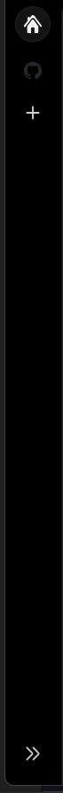
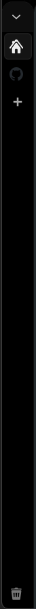
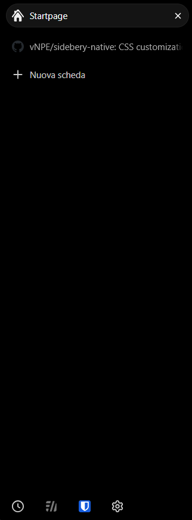
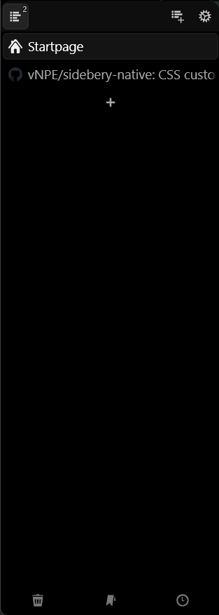

# Sidebery Native

A compact sidebar for Firefox and LibreWolf that expands on hover. Keep Sidebery's tab icons visible while browsing, then move the pointer over the sidebar to reveal tab titles and the tab tree.

The expanded sidebar overlays the page, so the page stays in place.

## Features

- **37px collapsed width** and **250px expanded width**, both customizable.
- **180ms animation** when expanding and collapsing.
- Optional [static mode](#disable-hover-and-use-a-static-sidebar) with a fixed sidebar width.
- Firefox's native sidebar column, tools and extensions buttons, toggle, and resize handles are hidden while Sidebery is open.
- Sidebar title and close-button headers are hidden for all sidebar panels.
- Rules for sidebars placed on either the left or right.
- CSS only, with no build step.

## Screenshots

Compare Firefox's native vertical sidebar with Sidebery Native in the same dark setup. Colors and tab styling depend on your browser theme and Sidebery settings.

| Native collapsed | Sidebery collapsed | Native expanded | Sidebery expanded |
| :---: | :---: | :---: | :---: |
|  |  |  |  |

**Collapsed:** Sidebery stays narrow with tab icons and a new-tab button. The styles editor snippet hides tab titles and close buttons and removes tree indentation so child-tab icons fit in the 37px sidebar.

**Expanded:** Moving the pointer over Sidebery widens it to 250px and restores its normal tab layout. Sidebery's own panel controls remain available; Firefox's separate tools column and the Sidebery title/close header are hidden. Moving back onto the page collapses the sidebar again.

## Requirements

- A recent desktop version of Firefox or LibreWolf with support for CSS nesting and `:has()`.
- [Sidebery](https://addons.mozilla.org/firefox/addon/sidebery/) installed. The internal styles below target Sidebery v5.

### Reference setup

The author's setup uses **LibreWolf 158.0-1** and **Sidebery 5.6.1**. This is the reference configuration for the screenshots and customization.

## Installation

### 1. Install Sidebery

Install [Sidebery from Mozilla Add-ons](https://addons.mozilla.org/firefox/addon/sidebery/) and open its sidebar.

Pin Sidebery's extension button to your browser toolbar so you can easily reopen it later. This customization hides Firefox's native sidebar toggle while Sidebery is open.

### 2. Enable custom browser styles

Open `about:config`, search for the following preference, and set it to `true`:

```text
toolkit.legacyUserProfileCustomizations.stylesheets
```

### 3. Install userChrome.css

1. Open `about:support`.
2. Find **Profile Folder** or **Profile Directory**, then open that folder using the button beside it.
3. Create a folder named `chrome` inside the active profile folder if it does not already exist.
4. Download [userChrome.css](userChrome.css) from this repository and save it inside `chrome`.
5. Fully quit and reopen the browser.

Your profile should contain:

```text
<active profile>/
└── chrome/
    └── userChrome.css
```

Use the profile folder, rather than the browser's installation folder. On Windows, check that the file is named `userChrome.css`, not `userChrome.css.txt`.

If you already have a `userChrome.css`, back it up and add this repository's CSS to it. Review any existing sidebar rules for conflicts before combining them.

The profile stylesheet setup is also described in [Sidebery's installation notes for custom browser styles](https://github.com/mbnuqw/sidebery#how-to-hide-native-tabs).

### 4. Add the Sidebery styles

In **Sidebery Settings → Styles editor**, select **Sidebar** and paste the CSS below. Depending on your version, the editor can also be opened through **Appearance → Edit styles**. See [Sidebery's styles editor documentation](https://github.com/mbnuqw/sidebery/wiki/Sidebery-Styles-Snippets).

```css
/* Compact tab layout while the sidebar is narrow. */
@media (max-width: 50px) {
  /* Keep child-tab icons visible by removing tree indentation. */
  #root {
    --tabs-indent: 0px !important;
  }

  /* Show icons without tab titles or close buttons. */
  .Tab .title,
  .Tab .close {
    display: none !important;
  }
}
```

The same snippet is available in [sidebery.css](sidebery.css).

These rules belong in **Sidebery's Styles editor**. The browser's sidebar sizing rules belong in **userChrome.css**. Both are needed for the compact tab layout.

When the sidebar expands beyond 50px, these overrides stop applying, restoring your normal Sidebery indentation, titles, and close-button settings. The selectors and indentation variable come from [Sidebery's tab styles](https://github.com/mbnuqw/sidebery/blob/v5/src/styles/sidebar/tab.styl).

### 5. Adjust the sidebar layout

Set Sidebery's navigation bar to a **horizontal layout** so a separate vertical navigation column does not use up the narrow sidebar width. If you use pinned tabs, placing them at the top also leaves more room for the main tab list.

Open Sidebery and move the pointer over the sidebar to expand it. Move back onto the page to collapse it.

Prefer a sidebar that stays open? Follow the [static mode instructions](#disable-hover-and-use-a-static-sidebar) below.

**Optional: remove the horizontal tab strip.** In Firefox, right-click the toolbar or tab strip and choose **Turn on Vertical Tabs**, then open Sidebery again. This customization hides the native vertical sidebar column while Sidebery is open. See [Mozilla's vertical tabs instructions](https://support.mozilla.org/en-US/kb/use-sidebar-access-tools-and-vertical-tabs).

## Customization

### Sidebar widths

Edit the settings near the top of `userChrome.css`:

```css
:root {
  --sidebery-collapsed: 37px;
  --sidebery-expanded: 250px;
}
```

Restart the browser after editing the profile stylesheet.

If you change the collapsed width, adjust the `50px` breakpoint in the Sidebery styles as needed. Keep it above the collapsed width and below the expanded width.

### Disable hover and use a static sidebar

To keep the sidebar permanently expanded, set **both width values to the same size** near the top of `userChrome.css`:

```css
:root {
  --sidebery-collapsed: 250px;
  --sidebery-expanded: 250px;
}
```

Restart the browser. The sidebar will stay at 250px, with no width change on hover. It reserves that width beside the page, so it stays open without covering the page. Tab titles and tree indentation use your normal Sidebery settings.

For a **permanently compact sidebar**, set both values to `37px` instead. With the supplied Sidebery styles, tab titles and close buttons stay hidden and tree indentation stays at zero.

You can use another fixed width by giving both values the same size. Keep the Sidebery styles' `50px` breakpoint in mind: those compact tab overrides apply whenever the sidebar is 50px wide or narrower.

To restore hover expansion, set the collapsed width back to `37px` and the expanded width to `250px`, then restart the browser.

### Animation speed

Change all five `180ms` durations in the `transition` declaration in `userChrome.css`. Keep them equal so the sidebar width and its compensating margins animate together.

### Restore sidebar headers

Remove the rule in **section 2** of `userChrome.css` to bring back the sidebar title and close button. That rule applies to every sidebar panel; the other customization rules are active only while Sidebery is open.

## Troubleshooting

### Nothing changes after restarting

Check that custom stylesheets are enabled, that the file is in the active profile's `chrome` folder, and that its name ends in `.css`. Fully exit the browser before reopening it, and make sure Sidebery is the open sidebar panel.

### Tab titles appear or child-tab icons are cut off when collapsed

Check that the Sidebery snippet is in the Styles editor's **Sidebar** section and that its width breakpoint matches your collapsed width. Use a horizontal navigation bar if another vertical column is taking up space.

### The sidebar is closed and the native toggle is gone

Use Sidebery's extension button to reopen it. Its button can be accessed from the browser's extensions menu if it is not pinned to the toolbar.

### The layout differs from the expected result

Other browser themes or sidebar styles can override these rules. Temporarily disable other sidebar customizations to check for conflicts. Browser updates can also change interface selectors; include your browser version, Sidebery version, and a screenshot when reporting an issue.

## Uninstall

1. Remove this customization from your profile's `userChrome.css`, or restore the backup you made before installing it.
2. Remove the snippet from Sidebery's Styles editor.
3. Fully quit and reopen the browser.

If your profile stylesheet contains only this customization, you can remove that file instead. Keep any unrelated custom rules you want to continue using.
